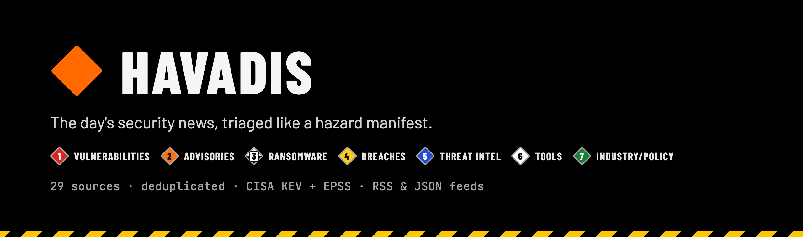
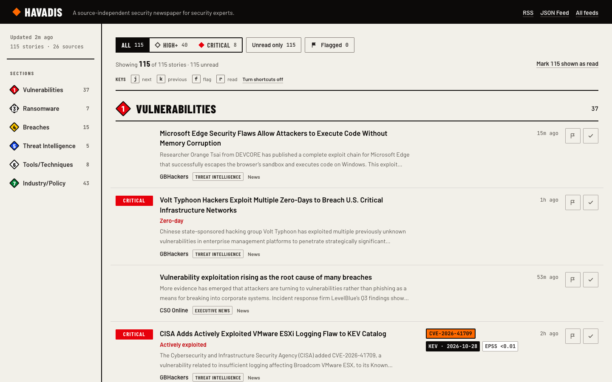

<div align="center">

<a href="https://havadis.netlify.app"></a>

**A public, source-independent daily security newspaper for security practitioners.**<br>
29 curated feeds, deduplicated, scored and sorted into seven urgency-ordered sections. No accounts, no database, no tracking.

[](https://havadis.netlify.app)
[](https://github.com/mfkocalar/havadis/actions/workflows/ci.yml)
[](LICENSE)
[](https://nextjs.org)
[](https://www.typescriptlang.org)
[](#subscribe)

[**Read today's edition**](https://havadis.netlify.app) · [Quick start](#quick-start) · [Subscribe](#subscribe) · [How it works](#how-it-works) · [Contributing](CONTRIBUTING.md) · [Security](SECURITY.md)

</div>

<picture>
  <source media="(prefers-color-scheme: dark)" srcset="docs/images/screenshot-dark.png">
  
</picture>

## Why Havadis

Security news is scattered across vendor blogs, CERTs, government advisories and trade press, and the same story shows up five times. Havadis reads all of it every few minutes and prints **one front page**: each story once, sorted by how urgently you need to act, with the reason it was ranked that way printed next to it.

- 🔴 **Know what to act on today.** Every story is scored **Critical**, **High** or **Normal** by transparent rules (actively exploited, zero-day, CISA KEV, emergency patch, …), and the reason is shown.
- 🧭 **Seven hazard classes.** Vulnerabilities, Advisories, Ransomware, Breaches, Threat Intelligence, Tools/Techniques and Industry/Policy, in urgency order.
- 🎯 **Exploitation signals inline.** CVE IDs link to NVD, with the CISA KEV date and FIRST EPSS probability beside them.
- 🧹 **No duplicates.** The same story from several outlets appears once.
- ⌨️ **Built for a fast morning pass.** Filter by importance or section, flag and mark read, and move with `j` / `k` / `f` / `r`. Everything stays in your browser.
- 📡 **Subscribe anywhere.** RSS 2.0 and JSON Feed for the whole page, by importance, or by section.
- ♿ **Accessible by default.** Light and dark themes, no meaning carried by colour alone, contrast gated in tests, 360px to 1440px.

<details>
<summary><b>Full feature reference</b></summary>


- **29 curated sources** (government and EU CERT advisories, security research, enterprise security, threat intelligence, tech and executive news), fetched in parallel. One failing feed never takes the page down.
- **Source-type label** on every story (News, Research, Vendor, CERT, Government), set per source in config.
- **Per-type lookback:** CERT, government and vendor items stay for 72 hours; news and research items for 24 hours. Low-cadence advisory feeds (CERT-EU, NCSC-UK) often have nothing inside the window on a given day, which is expected.
- **Deduplication:** the same story from several outlets appears once (canonical URL or normalized title match; the earliest copy wins).
- **Seven urgency-ordered sections:** Vulnerabilities, Advisories, Ransomware, Breaches, Threat Intelligence, Tools/Techniques, Industry/Policy, shown as numbered hazard classes 1 to 7 with placard-coloured diamonds. Classification is deterministic and keyword-based (see `src/lib/config/sections.ts`).
- **Ranking** within a section by source tier weight and recency.
- **Importance triage:** every article is scored Critical, High or Normal by deterministic rules, and the story shows the reason. Critical means act today (actively exploited, zero-day, CISA KEV, emergency patch). High means plan for it (critical severity, remote compromise, public exploit, supply-chain attack, ransomware, any CVE, or a Breaches story). Critical stories get a filled red placard and High stories an outlined one; the level is always printed as a word, never shown by colour alone.
- **CVE panels** on stories that mention a CVE ID: the ID on an orange identification panel, linking to the NVD entry.
- **Exploitation signals:** a CVE panel is followed by a KEV chip with the date CISA added the CVE to its Known Exploited Vulnerabilities catalog, and an EPSS chip with the FIRST exploitation probability (a muted "no EPSS yet" for brand-new CVEs). The strongest signal is shown first. When KEV or EPSS data is unavailable, stale or partial, a small notice appears next to "Updated"; nothing on the page ever says a CVE is safe or not exploited.
- **Client-side section filter:** multi-select section buttons with per-section counts, in a side rail from 1024px and a sticky scrolling strip below that. Filtering never triggers a network request.
- **Reader triage:** show All, High+ or Critical only, unread only or flagged only; flag or mark any story read, or mark everything shown as read. Choices and marks are kept in the browser's localStorage (marks for a week); nothing is sent to a server.
- **Keyboard triage:** `j` / `k` move to the next or previous visible story, `f` flags it and `r` marks it read (pressing the story's own Flag and Read buttons). Hidden or collapsed stories are skipped, and with "Unread only" on, `r` moves on to the next story. Shortcuts never fire in text fields or with a modifier key, and "Turn shortcuts off" in the triage bar disables them (WCAG 2.2 SC 2.1.4); that setting is kept in localStorage and survives "Reset filters".
- **Outbound feeds:** RSS 2.0 and JSON Feed for the whole front page, by importance, or by section (see [Feeds](#feeds)).
- **Freshness:** the rail shows when the snapshot was built ("Updated 14:05 UTC") with the story and source counts, and each story its publication time; both switch to relative ages after load and tick every minute.
- **Triage layout:** stories are rows, not cards. From 1280px each row keeps importance, story, exploitation signals, age and actions in fixed columns so a section compares top to bottom; narrower screens fold the row. Light and dark themes follow the OS. Verified from 360px phones to 1440px desktops.


</details>

## Quick start

Requires a current Node.js LTS.

```bash
git clone https://github.com/mfkocalar/havadis.git
cd havadis
npm install
npm run dev        # http://localhost:4000
```

Production build:

```bash
npm run build
npm start
```

The build prerenders from live feeds, so it needs outbound network access, including to `www.cisa.gov` (KEV) and `api.first.org` (EPSS).

## Subscribe

Other services and agents can subscribe to the front page. Every feed covers the last 24 hours, newest first, is prerendered and refreshed every 15 minutes, needs no key, and allows cross-origin requests.

| Feed | RSS 2.0 | JSON Feed 1.1 |
|------|---------|---------------|
| All stories | [`/feed.xml`](https://havadis.netlify.app/feed.xml) | [`/feed.json`](https://havadis.netlify.app/feed.json) |
| High and critical | [`/feed/high.xml`](https://havadis.netlify.app/feed/high.xml) | [`/feed/high.json`](https://havadis.netlify.app/feed/high.json) |
| Critical only | [`/feed/critical.xml`](https://havadis.netlify.app/feed/critical.xml) | [`/feed/critical.json`](https://havadis.netlify.app/feed/critical.json) |
| One section | `/feed/<section>.xml` | `/feed/<section>.json` |

Section slugs: `vulnerabilities`, `advisories`, `ransomware`, `breaches`, `threat-intelligence`, `tools-techniques`, `industry-policy`.

Each item carries Havadis's triage fields: section, importance, importance reason, CVE IDs, source and source tier. JSON Feed items have them in a `_havadis` object; RSS items have them as `havadis:` namespaced elements and `<category>` tags. The site's HTML advertises the feeds via `<link rel="alternate">`, and [`/feeds`](https://havadis.netlify.app/feeds) lists every endpoint.

```bash
curl -s https://havadis.netlify.app/feed/critical.json | jq '.items[] | {title, url, why: ._havadis.importance_reason}'
```

## How it works

```
29 RSS/Atom feeds
   → fetchSource (validated redirects, size cap, per-source timeout)
   → normalize → per-source lookback (72h cert/government/vendor, 24h news/research) → dedupe → classify + CVEs + importance → rank → group by section
   → one cached edition (src/lib/snapshot.ts, 900 s) ─┐
   CISA KEV catalogue → validated, slim map (6 h)  ───┼→ merged at render with EPSS (FIRST) → static, server-rendered page
```

The whole composed edition is cached once through Next's `unstable_cache` in `src/lib/snapshot.ts` (`getSnapshot`, `SNAPSHOT_REVALIDATE_SECONDS` = 900 seconds) and shared by every reader. Inside it each feed is fetched uncached, so a feed that fails during a refresh is missing from that edition until the next good refresh. A refresh that errors or composes zero articles keeps the previous edition, whose "Updated" time then shows its age. Parsing uses `rss-parser` on the fetched XML text. The front page is a static route. Client code is limited to the filters, triage controls, read and flag marks, and clocks; it receives only opaque article ids, closed enums, counts and timestamps, never feed text.

Exploitation signals are merged with the cached edition at render, so the page stays static. The CISA KEV catalogue is validated, slimmed to about 135 KB (at today's catalogue size) and cached for 6 hours under its own key; EPSS is requested at render in sorted batches of at most 50 CVEs with a 1-hour fetch cache.

Failure policy, one sentence each. Edition: the last good edition is kept, and a cold build (or the first build after a cache-key bump) fails during a total feed outage while Netlify keeps the previous deploy live. Enrichment: a stale KEV map beats an empty one, otherwise KEV and EPSS degrade to "unavailable", every article still renders, and unavailable is never shown as "not in KEV". The reasoning is written once in the header of `src/lib/snapshot.ts`.


## Configuration

| What | Where |
|------|-------|
| Sources, tiers and source types (adding or removing a source is a code change) | `src/lib/config/sources.ts` |
| Source-type labels and lookback windows | `src/lib/config/sourceTypes.ts` |
| Crawler identity (User-Agent, public contact URL and opt-out channel) | `src/lib/config/crawler.ts` |
| Section keywords | `src/lib/config/sections.ts` |
| Ranking weights | `src/lib/config/ranking.ts` |
| Per-section story cap (6 shown, then "Show all") | `src/lib/config/frontPageLayout.ts` |
| KEV and EPSS tunables (feed URLs, cache windows, size caps, timeouts, batch size) | `src/lib/enrichment/config.ts` |
| Importance rules (critical / high / normal) | `src/lib/pipeline/importance.ts` |

`SITE_URL` sets the public origin used for absolute links in feeds and metadata (e.g. `https://havadis.netlify.app`). It falls back to `http://localhost:4000`; set it in production. The crawler's contact URL points at this site's `/about` page.

## Development

| Command | What it does |
|---------|--------------|
| `npm run dev` | Start the development server |
| `npm run build` | Production build |
| `npm start` | Serve the production build |
| `npm run lint` | ESLint |
| `npm test` | Unit and production-page tests (build first: `npm run build && npm test`) |

### Testing

`npm test` runs hermetic tests plus production-build tests that read the last build in `.next`, so run `npm run build && npm test`. The static-route gate fails when `/` is no longer prerendered with a 900-second window, and fails with a stale-build message when any non-test file under `src/` or `next.config.ts` is newer than `.next/BUILD_ID`. Enrichment tests run against a local fixture server on 127.0.0.1 and never call CISA or FIRST. Live-network end-to-end tests are opt-in:

```bash
E2E=1 node --test src/lib/pipeline/frontpage.e2e.test.ts
```

Responsive layout is checked at six widths (360, 390, 768, 1024, 1280, 1440px) with an ad hoc Playwright script. Playwright is intentionally not a project dependency:

```bash
npm install --no-save playwright@1.63.0
npm run build
node scripts/verify-viewports.mjs
```


## Design

The front page uses a "hazard placard" visual system built for a fast morning triage pass: a warm vinyl ground (asphalt in dark mode), black ink rules, square 2px corners, and colour used only where it means something (section class, importance, exploitation signal). Type is Barlow Condensed for headings and labels, Barlow for reading and JetBrains Mono for IDs and figures, loaded through `next/font`. Tokens and rules are documented in [`DESIGN.md`](DESIGN.md); the audience and product principles behind them are in [`PRODUCT.md`](PRODUCT.md). Contrast for every control and chip tone is gated by `npm test` in both themes.

**Tech stack:** Next.js 16 (App Router, TypeScript), React 19, Tailwind CSS 4, `rss-parser`. Hosted on Netlify's free tier with no database; one scheduled function keeps the front page fresh.

## Deployment

Hosted on Netlify at https://havadis.netlify.app, which builds and deploys `main` with `npm run build`. A failed build is not published, so the previous deploy stays live.

Netlify rebuilds an expired page only when a request arrives, so `netlify/functions/refresh-front-page.mts` requests `/` every 5 minutes; readers then see an edition at most about 20 minutes old instead of whatever the last visitor left. It reads `SITE_URL`. Feeds are not warmed: they read the same cached edition as `/`, so a feed rebuild never crawls the sources, but a feed can still be stale until its first request after a quiet spell.

Set `SITE_URL=https://havadis.netlify.app` in the Netlify site's environment variables; without it, feed and metadata links point at `http://localhost:4000`. The crawler's contact URL (`src/lib/config/crawler.ts`) also points at this site's `/about` page, so update both if the domain changes.


## Contributing

Source suggestions, bug reports and pull requests are welcome. Read [CONTRIBUTING.md](CONTRIBUTING.md) first; to suggest a feed, open a [source request](https://github.com/mfkocalar/havadis/issues/new?template=source_request.yml).

## Security

Please don't report vulnerabilities in public issues. See [SECURITY.md](SECURITY.md) for how to report one privately.

## License

[MIT](LICENSE). Headlines and summaries belong to their publishers; Havadis links every story to its original source.
